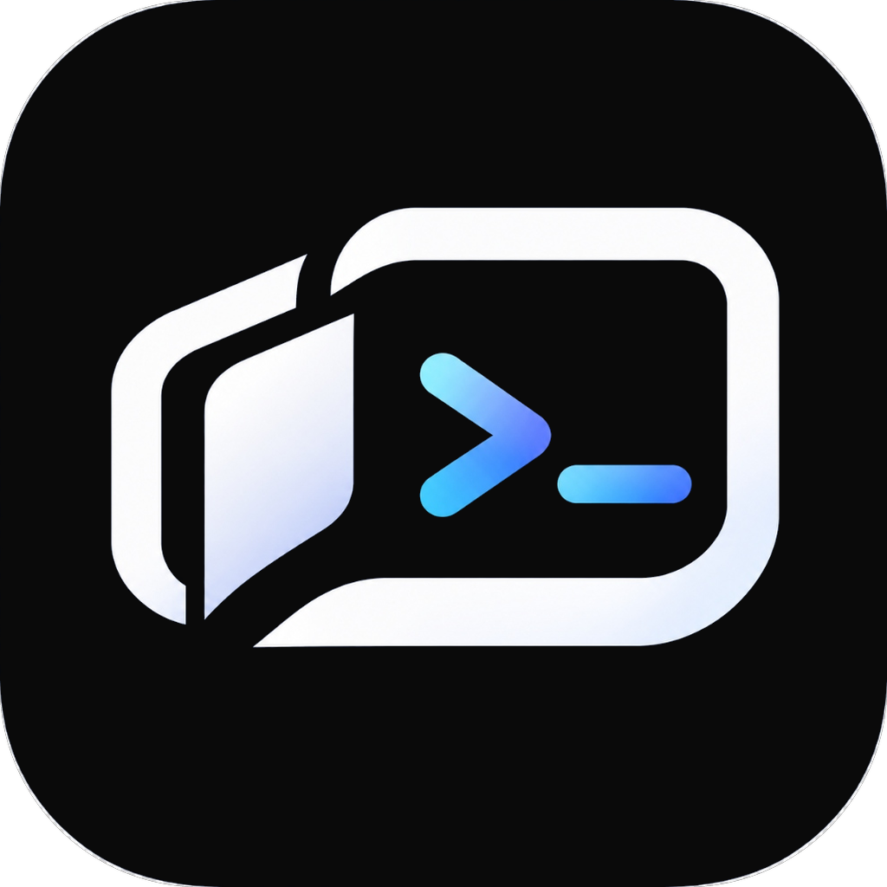

<p align="right"><a href="README.md">English</a> · <a href="docs/README.zh-CN.md">简体中文</a></p>

<p align="center">
  
</p>

<h1 align="center">Nexus</h1>

<p align="center">
  <strong>Dedicated Local AI Control Plane for ChatGPT, DeepSeek & Modern Web AI Assistants</strong><br>
  <i>Powered by the LocalBridge 332 Canonical MCP Tool Architecture & Durable Action Ledger</i>
</p>

<p align="center">
  <a href="#7-quick-start">Quick Start</a> · <a href="#1-overview">Overview</a> · <a href="#5-core-capabilities--architectural-highlights">Capabilities</a> · <a href="https://github.com/ysunyang4/webagent">WebAgent Extension</a> · <a href="https://blog.ycu.de5.net/">Blog & Docs</a> · <a href="PRIVACY.md">Privacy Policy</a> · <a href="https://github.com/ysunyang4/Nexus/issues">Issues</a> · <a href="LICENSE">License</a>
</p>

<p align="center">
  <a href="https://m8ven.ai/mcp/ysunyang4/nexus?s=readme"></a>
  
  <a href="LICENSE"></a>
</p>
<!-- M8ven Publisher Verification: [](https://m8ven.ai/mcp/ysunyang4-nexus-9j6zw4?s=readme) -->

Nexus is an enterprise-grade Local AI Control Plane designed specifically for ChatGPT, DeepSeek, and modern AI coding assistants. It securely bridges remote LLMs to your local workstation through a high-performance **Secure MCP Tunnel** (Streamable HTTP with Bearer tokens). Ask your assistant to inspect repositories, edit code, run builds, debug, or orchestrate complex local engineering workflows within strictly enforced sandbox boundaries—without exposing your full filesystem or transmitting proprietary code to untrusted cloud intermediaries.

<p align="center">
  <a href="https://trendshift.io/repositories/358532?utm_source=trendshift-badge&amp;utm_medium=badge&amp;utm_campaign=badge-trendshift-358532" target="_blank" rel="noopener noreferrer"></a>
</p>

---

## 1. Overview

```text
 ChatGPT / DeepSeek / Web AI Assistants
               │
               │ Secure MCP Tunnel (Streamable HTTP, Bearer lb_xxx)
               ▼
┌────────────────────────────────────────────────────────────────────────┐
│                   Nexus Desktop Control Center (Tauri 2)               │
│                                                                        │
│  Fastify MCP & REST API Server (Port 18080)   SQLite Persistence (WAL) │
└──────────────────────────────────┬─────────────────────────────────────┘
                                   │ Bidirectional JSON-RPC 2.0 (WebSocket)
                                   ▼
┌────────────────────────────────────────────────────────────────────────┐
│                   Nexus Local Runner Daemon                            │
│                                                                        │
│  ├── 332 Canonical MCP Tools Across 24 Capabilities                    │
│  ├── Action Ledger WAL (Crash Recovery & Idempotent Replay)            │
│  ├── Native Windows Computer Use (WinRT OCR, UI Automation)            │
│  ├── Sandboxed Workspaces & Managed Git Worktrees                      │
│  ├── Persistent Development Runtimes & Windows Job Objects             │
│  ├── Language Server Protocol (LSP - TypeScript / Python)              │
│  ├── Headless & Interactive Browser Automation Engine                  │
│  └── Local Intelligence Store (Memory, Rules, Knowledge, Prompts)      │
└────────────────────────────────────────────────────────────────────────┘
```

---

## 2. Desktop Control Center Showcase

The Nexus Desktop Control Center provides developers with real-time observability, granular security governance, and seamless tool management across all connected AI agents.

<div align="center">
  
  <p><i>Nexus Desktop Control Center: Real-time system telemetry, active workspaces, registered tools, and CPU/memory metrics.</i></p>
</div>

<br>

<div align="center">
  <table>
    <tr>
      <td width="50%">
        
        <p align="center"><b>Multi-Tier Security & Project Sandboxing</b><br>Granular read/write permissions, path isolation, and AST command risk controls.</p>
      </td>
      <td width="50%">
        
        <p align="center"><b>Skills Hub & Hot-Reload Engine</b><br>Zero-bloat modular tool orchestration with instant hot-reloading.</p>
      </td>
    </tr>
    <tr>
      <td width="50%">
        
        <p align="center"><b>Secure MCP Tunnel</b><br>Streamable HTTP tunnel with DPAPI encrypted credential vault.</p>
      </td>
      <td width="50%">
        
        <p align="center"><b>Managed MCP Process Ecosystem</b><br>Figma, GitHub, SQLite, Filesystem & dynamic agent runtimes.</p>
      </td>
    </tr>
  </table>
</div>

---

## 3. Generative & Procedural 3D Automation (Blender)

Nexus seamlessly bridges generative AI models directly into **Blender 4.x / 5.x**, enabling end-to-end procedural 3D modeling, geometry node orchestration, PBR procedural shader synthesis, and photorealistic asset generation directly from high-level conversational prompts.

<div align="center">
  
  <p><i>Autonomous 3D Scene Generation: Stylized Cartoon Cottage featuring procedural masonry, wooden framing, roof shingles, and atmospheric lighting.</i></p>
</div>

<br>

<div align="center">
  <table>
    <tr>
      <td width="50%">
        
        <p align="center"><b>Production-Grade Clean Quad Topology</b><br>Optimized edge flow, non-destructive modifiers, and game-ready mesh density.</p>
      </td>
      <td width="50%">
        
        <p align="center"><b>Procedural Hard-Surface & PBR Shading</b><br>Steampunk brass apparatus with real-time procedural glass and liquid shaders.</p>
      </td>
    </tr>
  </table>
</div>

---

## 4. Unity GameDev In-Editor AI Copilot

Transform your game development pipeline with the **Nexus Unity Copilot**. Operating directly inside the Unity Editor via bidirectional JSON-RPC MCP bridges, AI agents can construct scenes, author custom HLSL/Shader Graph shaders, configure physics, and validate gameplay logic in real time.

<div align="center">
  
  <p><i>Nexus In-Editor Copilot: Real-time generation of the gravitational lensing accretion disk and deep space photon ring.</i></p>
</div>

<br>

<div align="center">
  <table>
    <tr>
      <td width="50%">
        
        <p align="center"><b>AI Game Developer Tab & Custom Shaders</b><br>Interactive shader parameter tuning and in-editor inspector integration.</p>
      </td>
      <td width="50%">
        
        <p align="center"><b>Scene Hierarchy & Real-Time Simulation</b><br>Automated GameObject hierarchy construction, skybox configuration, and camera positioning.</p>
      </td>
    </tr>
  </table>
</div>

---

## 5. Core Capabilities & Architectural Highlights

#### 1. 332 Canonical MCP Tools
- **Single Source of Truth**: All 332 tools are formally defined in `@localbridge/protocol`, with strict input schemas, risk ratings, and automated evidence tracking.
- **Zero Hallucination Guarantee**: Covers 24 capability dimensions: Filesystem, Advanced FS, Git Operations, Command Execution, Persistent Background Jobs, LSP Code Intelligence, Managed Worktrees, Browser Automation, Windows Computer Use, Vision Analysis, Document Engineering, Local Intelligence (Memory/Rules/Knowledge), Agent Orchestration, and System Discovery.

#### 2. ACID-Compliant Action Ledger WAL
- **Write-Ahead Logging**: Every critical tool execution is recorded in a write-ahead log (`.wal`) prior to side-effect application.
- **Crash Recovery & State Replay**: Automatically recovers pending operations and restores consistent workspace states after host reboot or runner crashes.
- **Idempotency Guard**: Eliminates duplicate execution and resource waste during intermittent network reconnections.

#### 3. Native Windows Computer Use & Vision
- **Semantic UI Locating**: Combines WinRT Native OCR and UI Accessibility trees to locate screen elements without relying on fragile pixel coordinates.
- **Multi-Monitor Control**: Window switching, foregrounding, mouse tracking, drag-and-drop, and keystroke dispatching with non-bypassable human takeover controls.
- **Visual Validation**: Screenshot capture, image comparison, and difference inspection for automated UI testing.

#### 4. Durable Execution & Process Isolation
- **Windows Job Objects**: Enforces hard process hierarchy isolation, CPU quotas, and memory caps on spawned commands.
- **Terminal Daemon (node-pty)**: Stateful pseudo-terminal sessions with ANSI log streaming and exit code tracking.
- **Command Risk Engine**: AST-based command classification (`SAFE`, `CAUTION`, `DANGEROUS`) that blocks destructive system calls (`rm -rf /`, `format`, `reg delete`) by default.

#### 5. Local Intelligence Store
- **Vectorless & Vector Hybrid**: SQLite-backed fast exact-match and semantic retrieval for persistent project memory, team rules, knowledge documentation, and custom prompt templates.
- **Context Compactor**: Automatic token reduction and conversational compaction for extended multi-turn agent tasks.
- **Extensible Skills Engine**: Declarative deterministic workflows with dynamic candidate proposal, automated validation, and live hot-reloading.

#### 6. Multi-Tier Path Sandbox & Enterprise Security
- **Physical Canonical Containment**: Enforces containment inside authorized project roots via `fs.realpathSync.native` to eliminate directory traversal (`../`) and prefix-confusion attacks.
- **Symlink & Junction Escape Shield**: Blocks malicious symlinks and Windows NTFS directory junctions pointing outside project boundaries.
- **Dual Token Cryptographic Isolation**: MCP client tokens (`lb_...`) and Runner daemon tokens (`lbr_...`) are generated with 256-bit entropy and stored exclusively as SHA-256 hashes. Timing side-channel attacks are mitigated via `crypto.timingSafeEqual`.
- **Sensitive File Shield**: Automatically masks `.env*`, `*.pem`, `*.key`, `id_rsa`, `.git`, and cloud credentials.

---

## 6. Monorepo Project Layout

```text
Nexus/
├── apps/
│   ├── desktop/          # Tauri 2 + React + Vite Desktop Control Center
│   ├── runner/           # Local execution daemon (332 tools, Action Ledger, Computer Use)
│   ├── server/           # Fastify MCP Server with SQLite WAL persistence & REST API
│   └── bridge/           # Standalone Nexus MCP Bridge (ChatGPT / DeepSeek)
├── packages/
│   ├── protocol/         # Pure protocol types, 332 Canonical tool definitions, RPC schemas
│   ├── security/         # Sandboxing, path verification, and command risk engine
│   └── shared/           # Structured logger (Pino), config loader, crypto utilities
├── tests/                # Comprehensive test suites (190+ suites, 1200+ tests)
├── docs/                 # Architectural specifications, security models, and guides
├── artifacts/            # Production truth evidence, capability matrices, and audit ledgers
└── scripts/              # Build automation, bundling tools, and release scripts
```

---

## 7. Quick Start

#### Option A: Desktop Installer (Recommended)
1. Open the [v1.3.4 release page](https://github.com/ysunyang4/Nexus/releases/tag/v1.3.4) and download the installer package for your operating system:
   - **Windows (x64 Installer)**: `Nexus_1.3.4_x64-setup.exe`
   - **macOS (Universal DMG)**: `Nexus_1.3.4_universal.dmg`
   - **macOS (Apple Silicon DMG)**: `Nexus_1.3.4_aarch64.dmg`
   - **Linux (Debian/Ubuntu `.deb`)**: `Nexus_1.3.4_amd64.deb`
   - **Linux (Universal `.AppImage`)**: `Nexus_1.3.4_amd64.AppImage`
   - **Browser Userscript (Tampermonkey)**: `nexus-web-agent.user.js`
2. Run the installer. Nexus launches in your system tray with bundled Node.js runtime, language servers, and background runner daemon ready out of the box.

#### Option B: Build & Run from Source
Prerequisites: **Node.js >= 24**, **pnpm >= 10**, **Rust stable**.

```powershell
# 1. Clone the repository
git clone https://github.com/ysunyang4/Nexus.git
cd Nexus

# 2. Install workspace dependencies
pnpm install

# 3. Build core packages and applications
pnpm run build

# 4. Launch Desktop Control Center
pnpm --filter @localbridge/desktop dev
```

---

## 8. Connecting AI Clients

### Option A: WebAgent 2.0 Browser Extension (Recommended for ChatGPT / DeepSeek / Kimi / Qwen)
1. Install **[WebAgent v2.0.1](https://github.com/ysunyang4/webagent/releases/latest)** in Chrome / Edge (see the [Blog Setup Guide](https://blog.ycu.de5.net/)).
2. Open the WebAgent drawer → **Advanced Settings**, and confirm the server URL is:
   ```text
   http://127.0.0.1:8787
   ```
   *(Zero-token local loopback — no token configuration required.)*
3. Open ChatGPT, DeepSeek, Kimi, or Qwen in your browser and start invoking local Nexus tools directly.

> **Skills Hub Note:** Skills Hub starts clean by default (zero pre-bundled bloat). Mount any local skill directory (`SKILL.md` / `skill.yaml`) in **Skills Hub → Sources Management** with zero-copy hot-reloading.

### Option B: Remote Tunnel / Standard MCP Clients (ChatGPT Connectors / Cursor / Windsurf)

#### Step 1: Authorize a Local Project
1. Open Nexus Desktop Control Center.
2. Under **Workspace -> Projects**, click **Authorize Project** and select your directory (e.g., `D:\projects\my-app`).
3. Set **Access Mode** (`read-only` or `read-write`) and **Execution Mode** (`disabled`, `safe-only`, or `project-code`)—both can be dynamically switched at any time without restarting.

#### Step 2: Generate an MCP Client Token
1. Go to **Settings -> AI Connections** (or **Tokens**).
2. Click **Generate Token**, choose `MCP Client Token` (`lb_...`), and copy the displayed token.

#### Step 3: Configure Your AI Client

**ChatGPT / Custom GPT Actions**:
Add the Streamable HTTP endpoint (`http://127.0.0.1:18080/mcp` or your Cloudflare Tunnel URL) with header `Authorization: Bearer lb_your_token_here` (or OAuth 2.0).

**Standard MCP Client Configuration (`mcp_config.json` / Client Settings)**:
```json
{
  "mcpServers": {
    "nexus": {
      "url": "http://127.0.0.1:18080/mcp",
      "headers": {
        "Authorization": "Bearer lb_your_token_here",
        "MCP-Protocol-Version": "2024-11-05"
      }
    }
  }
}
```

**Cursor / Windsurf / Any MCP Client**:
- Transport: `Streamable HTTP`
- URL: `http://127.0.0.1:18080/mcp`
- Headers: `{"Authorization": "Bearer lb_your_token_here"}`

---

## 9. Community & Discussions

Join the discussion, report issues, and follow updates across channels:
- **Blog & Tutorials**: [https://blog.ycu.de5.net/](https://blog.ycu.de5.net/)
- **X (Twitter)**: [@yngstein](https://x.com/yngstein)
- **LINUX DO**: [yang_sunny](https://linux.do/u/yang_sunny/summary)
- **Reddit**: [u/OutrageousRabbit3296](https://www.reddit.com/user/OutrageousRabbit3296)
- **Issues & Bug Reports**: [GitHub Issues](https://github.com/ysunyang4/Nexus/issues)
- **Q&A & Community Discussions**: [GitHub Discussions](https://github.com/ysunyang4/Nexus/discussions)
- **Commercial Licensing & Enterprise Inquiries**: `ysunyang4@gmail.com`

---

## 10. 💖 Support & Sponsorship

If **Nexus** has accelerated your research, engineering workflow, or daily development, consider supporting the continuous open-source maintenance of this project. Donations are completely voluntary and help sustain infrastructure, active maintenance, and ecosystem development.

- **Afdian (爱发电)**: [https://afdian.com/a/ysunyang4](https://afdian.com/a/ysunyang4)

> 💼 **Enterprise Sponsorship & Commercial Licensing**  
> For enterprise sponsorship, dedicated SLA support, or commercial closed-source licensing inquiries (dual-licensing exempt from AGPL-3.0 copyleft obligations), feel free to reach out via [GitHub Issues](https://github.com/ysunyang4/Nexus/issues) or email: `ysunyang4@gmail.com`.

### Supported Contribution Channels

| 🟢 WeChat Pay | 🔵 Alipay | 🟡 Binance Pay |
| :---: | :---: | :---: |
|  |  |  |

| Method | Network / Platform | Address / Account | Notes |
| :--- | :--- | :--- | :--- |
| **USDT (on-chain)** | **TRON (TRC-20)** | `TPRrDW8DGsrDmcnWvanTbFz7XEJuywu21i` | Transfer from any wallet or exchange via **TRON (TRC-20)** |
| **Binance Pay** | Internal Transfer | **UID: `1292741809`** | Direct zero-fee internal transfer via Binance Pay |

> 🌟 **Thank you for your support.** Every contribution helps sustain active development, performance optimizations, and open-source toolkits.

### Official Security Notice

- **Unique Official Channels**: The on-chain address and Binance UID listed above are the **only** official donation channels for this project.
- **No Private Solicitation**: The maintainers of this project will **never** contact you privately via email, messaging apps, or social media to solicit funds, donations, or account credentials.
- **Anti-Impersonation**: If you encounter any fork, mirror, or distribution claiming to be this project with inconsistent donation details, please report it immediately via [GitHub Issues](https://github.com/ysunyang4/Nexus/issues).

### Disclaimer

- **Network & Regional Availability**: Crypto donations are subject to network handling and platform terms. Please verify whether Binance Pay is compliant and legally available in your region before transferring funds.
- **Taxation & Compliance**: Donors are solely responsible for complying with the tax obligations and legal regulations of their local jurisdictions.

---

## 11. Development & Quality Verification

```powershell
# Typecheck across all 7 workspace packages (0 errors)
pnpm run typecheck

# Build all packages, bundles, and Tauri resources
pnpm run build

# Run the test suite
pnpm run test

# Run Rust desktop check
cargo check --manifest-path apps/desktop/src-tauri/Cargo.toml
```

---

## 12. License, Anti-Rebranding & Security Disclaimer

- **Software license ([GNU AGPL-3.0](LICENSE))**: Nexus v1.3.4 is distributed under the GNU Affero General Public License v3.0 (AGPL-3.0-only), which permits personal **and commercial** use, modification and redistribution subject to its terms.
  - **When source obligations apply**: Distributing covered works (including modified binaries), and allowing users to interact over a network with a modified version, can trigger the license's corresponding-source and notice requirements. Private modifications not conveyed or offered as a modified network service are not automatically required to be publicly published. Refer to the actual [AGPL-3.0 license](LICENSE), especially Sections 4–6 and 13, for the precise scope.
  - **Attribution and accurate origin**: Preserve copyright, license and other legal notices as the AGPL requires, indicate relevant changes, and do not falsely represent modified builds as official releases. The AGPL's termination and reinstatement provisions are governed by Section 8; this README does not add an automatic-termination rule.
  - **Branding**: The software license does not automatically grant trademark rights or permission to imply official endorsement. See [Brand Guidelines](BRAND_GUIDELINES.md). These guidelines do not override AGPL-granted software freedoms.
  - **Third-party notices**: See [THIRD_PARTY_NOTICES.md](THIRD_PARTY_NOTICES.md) for dependencies and a separate architecture-reference acknowledgement.
- **Security & Unrestricted Mode Disclaimer ([SECURITY.md](SECURITY.md))**:
  - By default, Nexus enforces strict path sandboxing (`read-only`) and AST command risk filtering (`safe-only`).
  - If you explicitly enable `read-write`, `project-code`, Computer Use UI automation, or **Unrestricted / Full-Control Mode**, you assume full responsibility for all commands executed and files modified by connected AI models. Always back up critical work or use Git version control.
